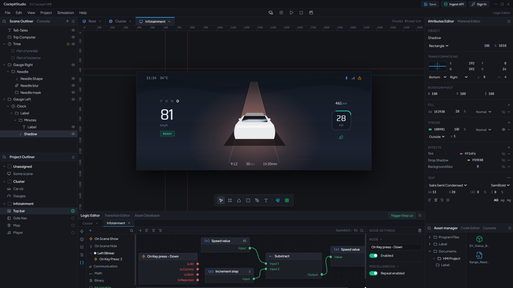
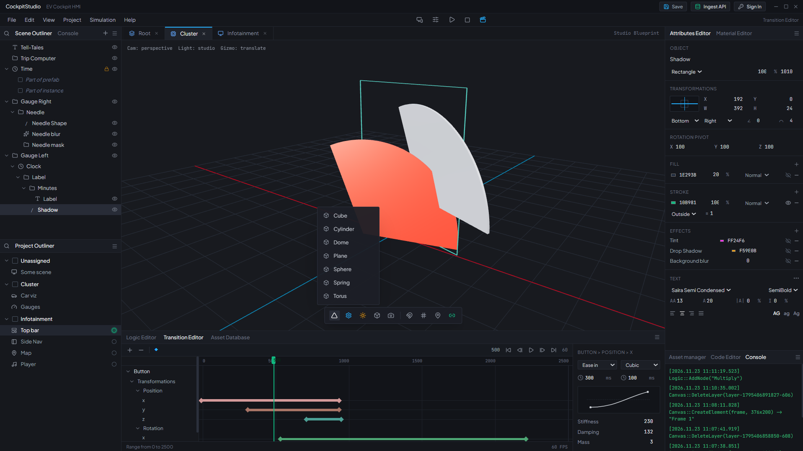

<div align="center">

# CockpitStudio

**Node-Based Automotive & Embedded HMI Authoring Studio with Real-Time 3D Visualization, Visual Logic Graphs, and External Telemetry Ingestion**

<p>
  
  
  
  
  
  
  
</p>

</div>

---

<table>
  <tr>
    <td width="50%" align="center">
      
      <br />
      <sub><strong>Cluster HMI Artboard &amp; Node-Based Logic Editor</strong> — Layer authoring, 3D EV cluster viz, live signal wiring</sub>
    </td>
    <td width="50%" align="center">
      
      <br />
      <sub><strong>3D Spatial Viewport &amp; Transition Timeline</strong> — TransformControls gizmo, PBR materials, spring/cubic easing</sub>
    </td>
  </tr>
</table>

---

## Key Capabilities

- **Interactive 2D HMI Authoring Canvas**: Pixel rulers, alignment crosshairs, 8px grid snapping, freehand vector/pen/frame/rectangle/text tools, drag & 4-corner resize handles, inline double-click text editing, and live style/effect binding (`Fill`, `Stroke`, `Tint`, `Drop Shadow`, `Background Blur`, `Typography`).
- **3D Spatial Viewport (`Three.js`)**: Real-time WebGL viewport with `OrbitControls`, `TransformControls` gizmo (`translate` / `rotate` / `scale`), procedural primitive & light creators (`Cube`, `Cylinder`, `Dome`, `Plane`, `Sphere`, `Spring`, `Torus`, `Directional/Point/Rim Lights`), camera & lighting presets, and bidirectional PBR material/transform sync.
- **Node-Based Logic & Transition Workbench**: Draggable logic nodes with pin-to-pin Bezier wiring, separate `Cluster` and `Infotainment` sub-graphs, node property inspector (`NODE SETTINGS`), plus keyframe timeline scrubbing (`30/60/120 FPS`) and interactive cubic/quadratic/spring easing curves.
- **PostgreSQL Workspace Persistence & External Ingest API**: `bcryptjs` + `HttpOnly` JWT authentication, project state snapshotting via Drizzle ORM, scoped `cs_live_*` API keys, and **Zod**-validated telemetry/signal ingestion endpoints for external CAN/HIL/backend systems (zero browser/backend mock telemetry injection).

---

## Project Structure

```text
CockpitStudio/
├── docs/                                # Documentation & workspace screenshots
│   ├── cockpitstudio-hmi-logic.png
│   └── cockpitstudio-3d-timeline.png
├── server/                              # Express API & PostgreSQL/Drizzle runtime
│   ├── auth.ts                          # JWT session cookies & cs_live_* API key hashing/guards
│   ├── db.ts                            # pg Pool (SSL-ready) & Drizzle ORM client
│   └── routes/
│       ├── auth.ts                      # /api/auth/* (register, login, logout, me, api-keys)
│       ├── projects.ts                  # /api/projects/* (CRUD workspace snapshots)
│       └── ingest.ts                    # /api/v1/* (Zod-validated telemetry, batch, signal ingest)
├── src/
│   ├── components/
│   │   ├── TopStudioBar.tsx             # Native-style menu bar, playback controls, save & modal triggers
│   │   ├── LeftOutlinerDock.tsx         # Scene Outliner, Console, Project Outliner, cascading Context Menu
│   │   ├── ClusterHmiCanvas.tsx         # Interactive 2D HMI artboard + Three.js EV vehicle centerpiece
│   │   ├── Viewport3D.tsx               # Three.js spatial viewport, gizmo, primitives & lighting dock
│   │   ├── BottomWorkbench.tsx          # Logic Editor, Transition Timeline Editor, Asset Database
│   │   ├── RightInspectorDock.tsx       # Attributes Editor, Material Editor, Asset Manager, Code Editor
│   │   └── AuthAndIngestModal.tsx       # Engineer auth, project manager, API keys & live ingest logs
│   ├── data/
│   │   └── defaultStudioState.ts        # Initial studio hierarchy, node graphs, tracks & HTML boilerplate
│   ├── db/
│   │   └── schema.ts                    # Drizzle PostgreSQL schema (5 relational tables)
│   ├── shared/
│   │   └── schemas.ts                   # Shared Zod validation schemas for auth, projects & ingest APIs
│   ├── types/
│   │   └── studio.ts                    # TypeScript interfaces for HMI layers, 3D transforms & logic graphs
│   ├── App.tsx                          # Studio state orchestration, keyboard shortcuts & API polling
│   ├── index.css                        # Tailwind CSS v4 + studio scrollbars & logic grid patterns
│   └── main.tsx                         # React 19 entry point
├── server.ts                            # Full-stack Express server (Vite middleware dev / dist static prod)
├── drizzle.config.ts                    # Drizzle Kit migration/push configuration
├── vite.config.ts                       # Vite bundler + Tailwind CSS v4 plugin
├── tsconfig.json                        # TypeScript configuration
└── .env.example                         # Environment variable template (secret-free)
```

---

## App System Architecture

```text
+-----------------------------------------------------------------------------------+
|                            CockpitStudio Web Client (SPA)                         |
|  React 19 + Tailwind v4 + Three.js (EV Cluster & 3D Viewport) + Node Graph UI     |
+--------------------+--------------------------------------+-----------------------+
                     | Session Cookie (HttpOnly JWT)        | Polling / Workspace Save
                     v                                      v
+-----------------------------------------------------------------------------------+
|                      Express 4 Server (server.ts, Port 3000)                      |
|  +------------------------+  +------------------------+  +---------------------+  |
|  | /api/auth/*            |  | /api/projects/*        |  | /api/v1/*           |  |
|  | Register/Login/Keys    |  | Scene/Logic/Code CRUD  |  | Zod Telemetry/Signal|  |
|  +-----------+------------+  +-----------+------------+  +----------+----------+  |
|              |                           |                          ^             |
+--------------+---------------------------+--------------------------|-------------+
               |                           |                          | Bearer cs_live_*
               v                           v                          | (x-api-key)
+-------------------------------------------------------+   +---------+-------------+
|         PostgreSQL (Supabase Pooler + SSL)            |   | External Systems      |
|  - cockpit_users            - cockpit_projects        |   | CAN Gateway / HIL Rig |
|  - cockpit_api_keys         - cockpit_telemetry_streams   | Telemetry Simulator   |
|  - cockpit_ingest_logs      (Managed via Drizzle ORM) |   | Edge Vehicle Broker   |
+-------------------------------------------------------+   +-----------------------+
```

### API Surface Overview

| Endpoint | Auth | Purpose |
| :--- | :--- | :--- |
| `GET /api/health` | Public | Liveness & PostgreSQL connectivity check |
| `POST /api/auth/register` & `/login` | Public | Engineer account auth (`bcryptjs` + `HttpOnly` JWT cookie) |
| `POST /api/auth/api-keys` | Session Cookie | Issue scoped `cs_live_*` keys for external telemetry writers |
| `GET / POST / PUT / DELETE /api/projects` | Session Cookie | Persist full HMI scene, attributes, logic graph, transitions & HTML |
| `POST /api/v1/ingest/telemetry` | `x-api-key` (`ingest:write`) | Ingest single Zod-validated vehicle telemetry frame |
| `POST /api/v1/ingest/batch` | `x-api-key` (`ingest:write`) | Ingest up to 500 frames per batch request |
| `POST /api/v1/ingest/signals` | `x-api-key` (`signals:write`) | Ingest arbitrary typed signal key-value maps |
| `GET /api/v1/telemetry/latest` | Session or API Key | Fetch latest telemetry snapshot & ingest audit logs |

---

## Tech Stack

| Layer | Technologies |
| :--- | :--- |
| **Frontend UI** | React 19, TypeScript, Tailwind CSS v4, Lucide Icons, Motion |
| **3D & Visualization** | Three.js (`WebGLRenderer`, `RoomEnvironment`, `OrbitControls`, `TransformControls`) |
| **Typography** | `Saira Semi Condensed`, `Plus Jakarta Sans`, `JetBrains Mono` |
| **Backend API** | Node.js 22 (native ESM `.ts`), Express 4, `cookie-parser`, `bcryptjs`, `jsonwebtoken` |
| **Database & Schema** | PostgreSQL (`pg` with SSL), Drizzle ORM (`drizzle-orm`, `drizzle-kit`) |
| **Validation** | Zod v4 (`src/shared/schemas.ts`) |
| **Build Tooling** | Vite 8, `@tailwindcss/vite`, `tsx` |

---

## How to Build

### 1. Configure Environment Variables

Copy `.env.example` to `.env` and fill in your PostgreSQL credentials and JWT signing secret:

```bash
cp .env.example .env
```

```env
PGHOST="aws-0-ap-south-1.pooler.supabase.com"
PGPORT="5432"
PGDATABASE="postgres"
PGUSER="postgres.your_project_ref"
PGPASSWORD="your_database_password"
PGSSL="true"
JWT_SECRET="replace-with-a-strong-random-secret"
PORT="3000"
```

### 2. Install Dependencies & Push Database Schema

```bash
npm install
npx drizzle-kit push --force
```

### 3. Run Development Server

```bash
npm run dev
```

Starts `server.ts` via `tsx` on **http://localhost:3000** with Vite middleware attached.

### 4. Typecheck & Production Build

```bash
npm run lint
npm run build
```

`npm run build` outputs the compiled frontend SPA into `dist/`.

---

## How to Deploy

CockpitStudio runs as a unified full-stack Node.js service serving both `/api/*` routes and the compiled static bundle from `dist/` on port `3000` (or `process.env.PORT`).

### Production Start (Node.js 22+)

```bash
npm ci
npm run build
npm start
```

`"start"` executes `NODE_ENV=production node server.ts` directly using Node 22 native TypeScript execution.

### Container / Cloud Run Deployment

1. Build container with Node `22-alpine` (or `22-slim`).
2. Run `npm ci && npm run build` during image build.
3. Inject production environment variables (`PGHOST`, `PGPORT`, `PGDATABASE`, `PGUSER`, `PGPASSWORD`, `PGSSL=true`, `JWT_SECRET`, `NODE_ENV=production`, `PORT=3000`) via your platform's secret manager.
4. Expose port `3000` and point your readiness/liveness probe to `GET /api/health`.
5. `server.ts` sets `app.set('trust proxy', 1)` so `Secure` / `HttpOnly` cookies work seamlessly behind HTTPS reverse proxies (Cloud Run, Nginx, Fly.io, Railway, Render).
